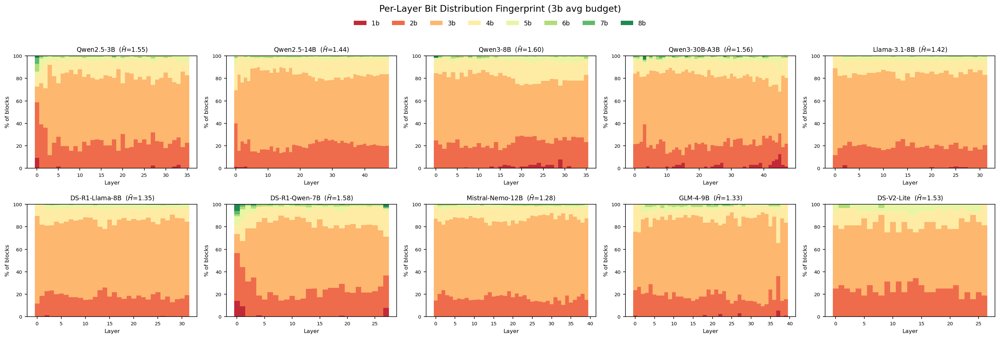

# Block-GTQ: RoPE-Block Rate Allocation for KV-Cache Quantization

[](https://arxiv.org/abs/2606.24033)

Block-GTQ allocates cached-key precision over the two-dimensional frequency
blocks of rotary position embeddings (RoPE). A blockwise logit-error bound
motivates a label-free query-key energy score. Under an average bit budget, the
allocator assigns higher rates to blocks with larger marginal benefit. We
instantiate the method with TurboQuant-MSE (TQ-MSE), grouping equal-rate blocks
to support attention over packed caches without materializing a decoded fp16 KV
cache.

**Paper and code status.** A revised version of
[arXiv:2606.24033](https://arxiv.org/abs/2606.24033) has been submitted; arXiv
may still display v1 until the replacement is announced. This repository
currently contains the original public code release. In particular, its packed
decode path uses Triton, while the revised paper's H800 deployment evaluation
uses a CUDA kernel and an updated FP16 FlashAttention-2 comparison. The
deployment scripts below are examples for the released code, not reproduction
commands for the revised deployment numbers.

## Results in the revised paper

- Across ten model configurations, Block-GTQ reduces layer-averaged RoPE-logit
  mean absolute error by 32–79% relative to uniform TQ-MSE at 3 logical key
  bits, improving all 367 layers. The 367/367 pattern also holds at 2 bits.
- On Llama-3.1-8B-Instruct at K2V2, the six-task needle-in-a-haystack average
  rises from 70.6 to 97.4, and the 16-task LongBench-EN average rises from 33.7
  to 44.9, relative to uniform TQ-MSE.
- On DeepSeek-R1-Distill-Qwen-7B at K3V2 without fp16 sink or recent-token
  buffers, Block-GTQ scores 49.6/38.8% avg@8 on AIME 2024/2025; uniform
  TQ-MSE scores 0/0, and fp16 scores 54.2/37.9%.
- In the revised Qwen2.5-3B-Instruct packed-cache evaluation on one H800, K3V3
  reduces resident KV memory from 4.83 to 1.49 GB at 128K (3.24×). Median
  decode latency is 9.50 versus 8.99 ms/step for FP16 FlashAttention-2 at
  128K, and 17.94 versus 19.50 ms/step at 1M. Quality is evaluated through
  128K; the longer-context measurements are execution tests.

## Installation

```bash
git clone https://github.com/JIA-Lab-research/blockgtq.git
cd blockgtq
conda create -n blockgtq python=3.10 -y
conda activate blockgtq
pip install -e ".[examples]"
```

The examples require a CUDA GPU, access to the model checkpoints they load, and
a compatible FlashAttention-2 installation for scripts that request it.

## Quickstart

- [`examples/quickstart_basic.py`](examples/quickstart_basic.py) runs the
  reference quantize/dequantize path.
- [`examples/quickstart_deployment.py`](examples/quickstart_deployment.py) runs
  the released Triton packed-cache path.

## Allocation diagnostics

Run [`bench/bench_perlayer_diag.py`](bench/bench_perlayer_diag.py) once per model
to save per-layer energy, allocation, and logit-error diagnostics. The 3-bit
results in the revised paper are:



| Model | Uniform TQ-MSE MAE | Block-GTQ MAE | Reduction | Layers improved |
|---|---:|---:|---:|---:|
| Qwen2.5-3B | 6.43 | **3.23** | 49.9% | 36/36 |
| Qwen2.5-14B | 4.14 | **2.61** | 37.1% | 48/48 |
| Qwen3-8B | 5.81 | **2.96** | 49.0% | 36/36 |
| Qwen3-30B-A3B | 6.76 | **3.00** | 55.6% | 48/48 |
| Llama-3.1-8B | 3.80 | **2.55** | 32.7% | 32/32 |
| DeepSeek-R1-Distill-Llama-8B | 3.44 | **2.33** | 32.2% | 32/32 |
| DeepSeek-R1-Distill-Qwen-7B | 11.44 | **2.40** | 79.1% | 28/28 |
| Mistral-Nemo-12B | 3.46 | **2.28** | 34.2% | 40/40 |
| GLM-4-9B | 7.30 | **4.51** | 38.2% | 40/40 |
| DeepSeek-V2-Lite | 6.01 | **3.87** | 35.5% | 27/27 |

The GLM diagnostic covers its partial-RoPE logits. The DeepSeek-V2-Lite
diagnostic covers its RoPE branch, not the full MLA latent cache. See the
paper's protocol appendix for the exact model and path scope.

## Calibration and benchmark examples

Build a calibration cache for the reference path:

```bash
python examples/build_calib_cache.py \
    --model meta-llama/Llama-3.1-8B-Instruct --n-tokens 2048 \
    --out calib_llama31_8b.pt
```

The default calibration text is
[`calib_data/wikitext2_calib_2k.txt`](calib_data/wikitext2_calib_2k.txt).
Pass `--prompt-file` to use another plain-text corpus.

Six-task needle-in-a-haystack example:

```bash
python bench/bench_niah.py \
    --model meta-llama/Llama-3.1-8B-Instruct --device cuda:0 \
    --context-lengths 4096 8192 16384 32768 65536 131072 \
    --k-bits 2 --v-bits 2 \
    --tasks single distractor multi multikey multivalue multiquery \
    --calib-cache calib_llama31_8b.pt --n-trials 3
```

LongBench example using four tasks from the released runner:

```bash
LONGBENCH_DATA_DIR=/path/to/longbench/data \
python bench/bench_longbench.py \
    --model meta-llama/Llama-3.1-8B-Instruct \
    --calib-cache calib_llama31_8b.pt --k-bits 2 --v-bits 2 \
    --subtasks qasper hotpotqa multifieldqa_en passage_retrieval_en
```

Download the LongBench data from
[THUDM/LongBench](https://huggingface.co/datasets/THUDM/LongBench). The public
runner defaults to an 8-task subset and does not yet contain the full 16-task
configuration used for the revised paper's LongBench-EN average.

Single-seed AIME example using the released runner:

```bash
python bench/bench_aime.py \
    --model deepseek-ai/DeepSeek-R1-Distill-Qwen-7B \
    --datasets aime24 aime25 --k-bits 3 --v-bits 2 \
    --methods fp16 Block-GTQ TQ-MSE --setting nobuffer --seeds 42
```

This command is a code example, not the revised paper's avg@8 protocol.

## Packed-cache code

[`examples/quickstart_deployment.py`](examples/quickstart_deployment.py) and
[`bench/bench_decode_e2e.py`](bench/bench_decode_e2e.py) exercise the original
Triton packed-cache implementation. They do not implement the revised paper's
CUDA kernel or its matched whole-step CUDA-graph comparison with native-GQA
FP16 FlashAttention-2. Please use the revised paper, rather than this
repository's original deployment figure or benchmark script, for the H800
latency and memory results summarized above.

## Citation

```bibtex
@misc{liang2026blockgtq,
  title         = {Block-GTQ: RoPE-Block Rate Allocation for KV-Cache Quantization},
  author        = {Fengfeng Liang and Yuechen Zhang and Jiaya Jia},
  year          = {2026},
  eprint        = {2606.24033},
  archivePrefix = {arXiv},
  primaryClass  = {cs.LG}
}
```
