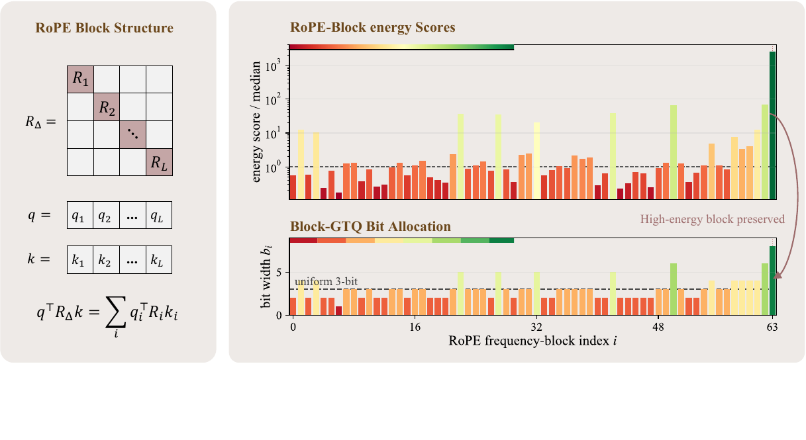
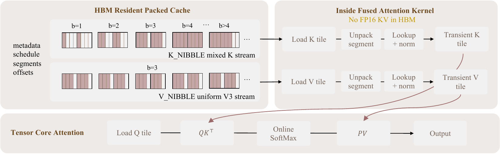

# Block-GTQ: RoPE-Block Rate Allocation for KV-Cache Quantization

[](https://arxiv.org/abs/2606.24033)

Block-GTQ allocates cached-key precision over the two-dimensional frequency
blocks of rotary position embeddings (RoPE). A blockwise logit-error bound
motivates a label-free query-key energy score. Under an average bit budget, the
allocator assigns higher rates to blocks with larger marginal benefit. We
instantiate the method with TurboQuant-MSE (TQ-MSE), grouping equal-rate blocks
to support attention over packed caches without materializing a decoded fp16 KV
cache.

Illustration of Block-GTQ's RoPE-block bit allocation:



Illustration of the packed-cache deployment path:



## Paper Highlights

- **Training-free allocation.** Block-GTQ uses unlabeled calibration data to
  give more key-cache bits to the RoPE blocks that need them. It requires no
  model fine-tuning or task labels.
- **Broad model coverage.** With only keys quantized at average rates of 2 or
  3 bits, Block-GTQ lowers attention-score error versus uniform TQ-MSE in
  every tested layer across ten models.
  Long-context and reasoning tests also show gains, including LongBench on
  Llama-3.1-70B-Instruct.
- **Less memory at competitive speed.** On one H800, Block-GTQ's K3V3 packed
  cache for Qwen2.5-3B-Instruct reduces resident KV memory by 3.24× and keeps
  perplexity close to fp16 at 128K, the longest context used for quality
  evaluation. Decode latency improves relative to FP16 FlashAttention-2 as
  context grows (+11.4% at 32K → −8.0% at 1M). At 1M, median decode latency
  falls from 19.50 to 17.94 ms/step.
- **Strong quality at low bit rates.** At K3V2, Block-GTQ keeps
  DeepSeek-R1-Distill-Qwen-7B's AIME performance close to fp16 even without
  fp16 sink or recent-token buffers; uniform TQ-MSE scores zero on both AIME
  years.

## Installation

```bash
git clone https://github.com/JIA-Lab-research/blockgtq.git
cd blockgtq
conda create -n blockgtq python=3.10 -y
conda activate blockgtq
pip install -e ".[examples]"
```

## Quickstart

- [`examples/quickstart_basic.py`](examples/quickstart_basic.py) runs the
  reference quantize/dequantize path.
- [`examples/quickstart_deployment.py`](examples/quickstart_deployment.py) runs
  the released Triton packed-cache path.

## Allocation diagnostics

Run [`bench/bench_perlayer_diag.py`](bench/bench_perlayer_diag.py) once per model
to save per-layer energy, allocation, and logit-error diagnostics. The 3-bit
results in the revised paper are:


| Model | Uniform TQ-MSE MAE | Block-GTQ MAE | Reduction | Layers improved |
|---|---:|---:|---:|---:|
| Qwen2.5-3B | 6.43 | **3.23** | 49.9% | 36/36 |
| Qwen2.5-14B | 4.14 | **2.61** | 37.1% | 48/48 |
| Qwen3-8B | 5.81 | **2.96** | 49.0% | 36/36 |
| Qwen3-30B-A3B | 6.76 | **3.00** | 55.6% | 48/48 |
| Llama-3.1-8B | 3.80 | **2.55** | 32.7% | 32/32 |
| DeepSeek-R1-Distill-Llama-8B | 3.44 | **2.33** | 32.2% | 32/32 |
| DeepSeek-R1-Distill-Qwen-7B | 11.44 | **2.40** | 79.1% | 28/28 |
| Mistral-Nemo-12B | 3.46 | **2.28** | 34.2% | 40/40 |
| GLM-4-9B | 7.30 | **4.51** | 38.2% | 40/40 |
| DeepSeek-V2-Lite | 6.01 | **3.87** | 35.5% | 27/27 |

## Calibration and benchmark examples

Build a calibration cache for the reference path:

```bash
python examples/build_calib_cache.py \
    --model meta-llama/Llama-3.1-8B-Instruct --n-tokens 2048 \
    --out calib_llama31_8b.pt
```

The default calibration text is
[`calib_data/wikitext2_calib_2k.txt`](calib_data/wikitext2_calib_2k.txt).
Pass `--prompt-file` to use another plain-text corpus.

Six-task needle-in-a-haystack example:

```bash
python bench/bench_niah.py \
    --model meta-llama/Llama-3.1-8B-Instruct --device cuda:0 \
    --context-lengths 4096 8192 16384 32768 65536 131072 \
    --k-bits 2 --v-bits 2 \
    --tasks single distractor multi multikey multivalue multiquery \
    --calib-cache calib_llama31_8b.pt --n-trials 3
```

LongBench example (four tasks):

```bash
LONGBENCH_DATA_DIR=/path/to/longbench/data \
python bench/bench_longbench.py \
    --model meta-llama/Llama-3.1-8B-Instruct \
    --calib-cache calib_llama31_8b.pt --k-bits 2 --v-bits 2 \
    --subtasks qasper hotpotqa multifieldqa_en passage_retrieval_en
```

### NIAH and LongBench-EN results

The following tables reproduce the revised paper's main long-context results.
NIAH reports percentages averaged over six subtasks—single-needle, distractor,
multi-needle, multi-key, multi-value, and multi-query—across 4K–128K tokens and
11 depths, with three trials per cell. LongBench-EN reports the average score
over 16 subtasks; the four-task command above is only a code example.

**Six-task NIAH**

| Backbone | Rate | fp16 | Uniform TQ-MSE | Block-GTQ |
|---|---|---:|---:|---:|
| Llama-3.1-8B-Instruct | K3V3 | 99.55 | 97.73 | **98.40** |
| Llama-3.1-8B-Instruct | K2V2 | 99.55 | 70.62 | **97.36** |
| Qwen2.5-7B-Instruct | K3V3 | 72.22 | 0.00 | **72.25** |
| Qwen2.5-7B-Instruct | K2V2 | 72.22 | 0.00 | **61.70** |

**LongBench-EN (Avg16)**

| Backbone | Rate | fp16 | Uniform TQ-MSE | Block-GTQ |
|---|---|---:|---:|---:|
| Llama-3.1-8B-Instruct | K3V3 | 49.73 | 47.37 | **48.56** |
| Llama-3.1-8B-Instruct | K2V2 | 49.73 | 33.67 | **44.89** |
| Llama-3.1-70B-Instruct | K3V3 | 52.66 | 51.77 | **52.39** |
| Llama-3.1-70B-Instruct | K2V2 | 52.66 | 47.20 | **50.14** |

The AIME 2024/2025 example below uses
[`bench/bench_aime.py`](bench/bench_aime.py) in no-buffer and with-buffer settings:

```bash
# no-buffer (every key quantized)
python bench/bench_aime.py \
    --model deepseek-ai/DeepSeek-R1-Distill-Qwen-7B \
    --datasets aime24 aime25 --k-bits <K_BITS> --v-bits <V_BITS> \
    --methods fp16 Block-GTQ TQ-MSE --setting nobuffer --seeds <Seeds>

# with-buffer (sink=4, recent fp16 window=128)
python bench/bench_aime.py \
    --model deepseek-ai/DeepSeek-R1-Distill-Qwen-7B \
    --datasets aime24 aime25 --k-bits <K_BITS> --v-bits <V_BITS> \
    --methods fp16 Block-GTQ TQ-MSE --setting withbuffer --seeds <Seeds>
```

### AIME 2024/2025 results

Scores are avg@8 (%) at nominal K3V2. **Stress** has no fp16 sink or
recent-token buffer. In the **Protected** setting, methods that support token
buffers retain four initial fp16 sink tokens and 128 recent fp16 tokens. Other
methods use method-specific protection; KVQuant, for example, retains 0.5%
sparse fp16 outliers. Block-GTQ and uniform TQ-MSE form the controlled
allocation comparison; the other methods provide cross-family context where
supported. Bold marks the highest reported quantized score in each column.

**Stress**

| Method | DS-R1-Llama-8B '24 | DS-R1-Llama-8B '25 | DS-R1-Qwen-7B '24 | DS-R1-Qwen-7B '25 |
|---|---:|---:|---:|---:|
| **Controlled allocation comparison** | | | | |
| fp16 | 43.33 | 28.75 | 54.17 | 37.92 |
| Uniform TQ-MSE | 26.25 | 20.00 | 0.00 | 0.00 |
| Block-GTQ | 27.50 | 25.42 | **49.58** | **38.75** |
| **Cross-family context** | | | | |
| KIVI-ScaleOnly | 7.50 | 10.42 | 28.75 | 17.50 |
| AATC | 4.58 | 3.75 | 25.00 | 23.75 |
| AATC (variance-only) | 1.25 | 0.83 | 25.00 | 24.17 |
| AQUA-KV<sup>*</sup> | **37.92** | **29.17** | 0.00 | 0.00 |
| Kitty<sup>†</sup> | — | — | — | — |
| CommVQ | 7.50 | 6.67 | 14.58 | 17.92 |
| KVQuant-0.01% | 1.25 | 0.00 | 25.42 | 20.83 |
| PM-KVQ (matched)<sup>‡</sup> | 15.42 | 3.33 | 18.33 | 4.17 |

**Protected**

| Method | DS-R1-Llama-8B '24 | DS-R1-Llama-8B '25 | DS-R1-Qwen-7B '24 | DS-R1-Qwen-7B '25 |
|---|---:|---:|---:|---:|
| **Controlled allocation comparison** | | | | |
| fp16 | 43.33 | 28.75 | 54.17 | 37.92 |
| Uniform TQ-MSE | 37.92 | 26.67 | 7.50 | 8.75 |
| Block-GTQ | **43.75** | **30.00** | **54.17** | **37.50** |
| **Cross-family context** | | | | |
| KIVI | 43.33 | 27.08 | 52.92 | 35.83 |
| AATC | 35.00 | 29.58 | 36.25 | 28.33 |
| AATC (variance-only) | 40.42 | 27.50 | 43.33 | 26.25 |
| AQUA-KV<sup>*</sup> | 43.33 | **30.00** | 0.00 | 0.00 |
| Kitty | 40.83 | 28.33 | 50.42 | **37.50** |
| CommVQ | 33.33 | 25.42 | 37.92 | 29.17 |
| KVQuant-0.5% | 16.67 | 20.42 | 39.58 | 27.92 |
| PM-KVQ (matched)<sup>‡</sup> | 19.58 | 6.25 | 18.33 | 6.67 |

- <sup>*</sup> AQUA-KV exhibits generation collapse on DS-R1-Qwen-7B.
- <sup>†</sup> Kitty requires an fp16 buffer, and smaller groups increase
  metadata cost; no rate-matched Stress setting is available.
- <sup>‡</sup> PM-KVQ uses offline reference generation lengths to set
  per-problem memory budgets. Method-specific settings and rate accounting are
  detailed in the paper's appendix.

## Deployment

The released code includes a Triton packed-cache decode path. To run its
Qwen2.5-3B-Instruct K3V3 benchmark on a CUDA GPU:

```bash
# FP16, Block-GTQ, and uniform TQ-MSE through 128K
python bench/bench_decode_e2e.py --configs K3V3 \
    --t-points 4096 16384 65536 131072 \
    --measure-ppl --ppl-tokens 1000 --prewarm-kernel

# Block-GTQ and uniform TQ-MSE at 256K and 512K
python bench/bench_decode_e2e.py --configs K3V3 \
    --t-points 262144 524288 \
    --skip-fp16 --prewarm-kernel
```

The revised CUDA kernel will be released soon.

## Hardware support

Block-GTQ's calibration, bit-allocation, and reference quantize/dequantize
paths run on CUDA GPUs using PyTorch and Triton. The released fused decode
kernel targets NVIDIA Hopper GPUs.

| Backend | Fused decode kernel in this repository |
|---|---|
| Hopper (H800 / SM90) | Triton implementation available |
| Apple MLX (M-series) | Coming soon |

## Citation

```bibtex
@misc{liang2026blockgtq,
  title         = {Block-GTQ: RoPE-Block Rate Allocation for KV-Cache Quantization},
  author        = {Fengfeng Liang and Yuechen Zhang and Jiaya Jia},
  year          = {2026},
  eprint        = {2606.24033},
  archivePrefix = {arXiv},
  primaryClass  = {cs.LG}
}
```
